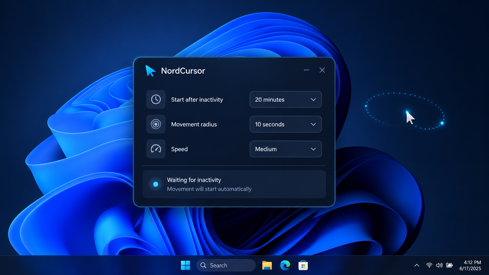

# NordCursor

**NordCursor** — компактная утилита для Windows, которая после заданного периода физической неактивности начинает плавно перемещать указатель мыши по небольшой окружности. Её задача — поддерживать активность курсора; в работающем режиме программа также запрашивает у Windows предотвращение автоматического перехода в сон и выключения дисплея.

## Возможности

- Автоматический запуск отслеживания неактивности после запуска скрипта (**режим включён по умолчанию**).
- Задержка перед движением: **15 секунд, 30 секунд, 1 минута или 5 минут**; по умолчанию — **30 секунд**.
- Радиус кругового движения: **1, 5 или 20 px**; по умолчанию — **5 px**.
- Скорость: **Smooth, Normal, Fast**; по умолчанию — **Smooth**.
- При возобновлении физической активности пользователя или обнаружении перемещения мыши извне автоматическое движение прекращается.
- Кнопка **Pause / Resume** на панели и в системном трее.
- Компактное окно **432 × 332 px** со скруглениями, голубыми обводками, glow-элементами и индикатором состояния.
- При скрытии главного окна в трей утилита продолжает работать.

## Требования и запуск

1. Установите [AutoHotkey v2](https://www.autohotkey.com/).
2. Сохраните `NordCursor_Glow.ahk` в удобную папку.
3. Запустите `.ahk` двойным щелчком.
4. При необходимости настройте задержку, радиус и скорость — **отслеживание включено сразу**, отдельно нажимать «Старт» не нужно.

Отрисовка интерфейса работает через системный **GDI+**; сторонние графические библиотеки не требуются.

## Параметры

| Поле в программе | Значения | По умолчанию |
| --- | --- | --- |
| `Start after inactivity` | 15 sec · 30 sec · 1 min · 5 min | 30 sec |
| `Movement radius` | 1 px · 5 px · 20 px | 5 px |
| `Speed` | Smooth · Normal · Fast | Smooth |

После истечения периода физической неактивности программа запоминает положение указателя и начинает двигать его по небольшой окружности. Проверка бездействия и шаг движения выполняются таймерами с периодом примерно 40 мс.

## Управление

| Элемент | Действие |
| --- | --- |
| **Pause / Resume** | Выключает или снова включает работу NordCursor. |
| **Статус** | Показывает ожидание неактивности, движение курсора или паузу. |
| **—** | Сворачивает окно. |
| **×** | Скрывает окно в системный трей; не завершает программу. |
| **Трей → Open NordCursor** | Открывает окно. |
| **Трей → Pause / Resume** | Переключает работу без открытия окна. |
| **Трей → Exit** | Полностью завершает утилиту. |

## Важное поведение

В активном состоянии программа вызывает Windows API `SetThreadExecutionState` с флагами, запрашивающими предотвращение автоматического сна системы и выключения экрана. **Это действие независимо от движения курсора**: даже пока движение ещё не началось, запрос уже действует. При паузе или завершении запрос снимается.

При изменении задержки или радиуса автоматическое движение останавливается и отсчёт начинается заново. Изменение скорости обновляет темп движения. Значения настроек **не сохраняются между перезапусками**.

Для игр, графических редакторов, удалённых рабочих столов и других приложений, где важно неподвижное положение курсора, используйте паузу. Программа не гарантирует, что корпоративные политики и сторонние механизмы блокировки экрана будут изменены.

Иконка `NordCursor_Transparent.ico` доступна как отдельный ресурс, **но текущий `.ahk` не назначает её автоматически**. Для запуска скрипта требуется AutoHotkey v2; автономный `.exe` не входит в комплект.

## Состав

`NordCursor_Glow.ahk` — исходный код приложения; `README.md` — инструкция; `CHANGELOG.md` — история подтверждённых изменений. При необходимости добавьте `NordCursor_Transparent.ico` для оформления сборки или ярлыка.
